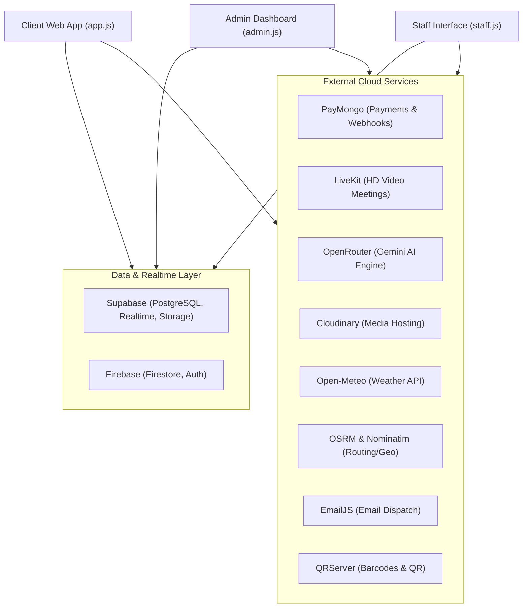

# SmartServe System API Inventory & Technical Integration Reference

This document provides a comprehensive technical breakdown of all Application Programming Interfaces (APIs), third-party cloud services, software development kits (SDKs), and native browser interfaces utilized throughout the **SmartServe** catering reservation, inventory management, and event execution system.

---

## Architecture Overview

SmartServe utilizes a hybrid distributed architecture:
- **Primary Relational & Real-Time Engine**: Supabase (PostgreSQL with Row-Level Security, WebSocket Realtime channels, Storage buckets).
- **Secondary Document Store & Legacy Sync**: Google Firebase (Firestore and Firebase Authentication).
- **Cloud Media Hosting & Optimization**: Cloudinary CDN.
- **Artificial Intelligence Assistant**: OpenRouter API (Google Gemini / Claude models).
- **Payment Processing**: PayMongo API (GCash, Maya, Debit/Credit Card).
- **Video/Audio Conferencing**: LiveKit Cloud WebRTC.
- **Weather & Environmental Forecasting**: Open-Meteo API.
- **Geographic Routing & Mapping**: Open Source Routing Machine (OSRM), Nominatim (OpenStreetMap), and Leaflet.js.
- **Transactional Notifications**: EmailJS API.
- **Asset Barcoding & Identification**: QRServer API and QRCode.js.
- **Hardware & Device Integration**: HTML5 Geolocation, MediaDevices (Camera), Desktop Notifications, and Web Speech Synthesis.

---

## Detailed API Specifications

### 1. Supabase REST, Realtime & Storage API
- **Vendor / Platform**: Supabase (PostgreSQL on AWS)
- **Primary Source Files**:
  - [`supabase-init.js`](file:///c:/Users/Admin/Desktop/SMARTSERVE/supabase-init.js)
  - [`admin.js`](file:///c:/Users/Admin/Desktop/SMARTSERVE/admin.js)
  - [`app.js`](file:///c:/Users/Admin/Desktop/SMARTSERVE/app.js)
  - [`staff.js`](file:///c:/Users/Admin/Desktop/SMARTSERVE/staff.js)
  - [`calendar.js`](file:///c:/Users/Admin/Desktop/SMARTSERVE/calendar.js)
  - [`service-worker.js`](file:///c:/Users/Admin/Desktop/SMARTSERVE/service-worker.js)
- **Protocols & Endpoints**:
  - RESTful Data Endpoint: `https://[SUPABASE_PROJECT_ID].supabase.co/rest/v1/`
  - Realtime WebSocket: `wss://[SUPABASE_PROJECT_ID].supabase.co/realtime/v1/websocket`
  - Storage Bucket API: `https://[SUPABASE_PROJECT_ID].supabase.co/storage/v1/object/catalog-pictures/`
- **Tables & Buckets Handled**:
  - `reservations`: Complete reservation records, contract states, and client info.
  - `inventory`, `inventory_categories`, `inventory_audit_log`, `inventory_batches`, `inventory_barcodes`: Asset inventory tracking, lifecycle tracking, unit costs, and condition auditing.
  - `routine_checks`, `maintenance_records`, `service_lifecycle`: Preventative maintenance, weekly inspection checklists, and disposal logs.
  - `equipment_allocations`: Dynamic reservations-to-equipment reservation reservations and conflict resolution.
  - `catalog_items`, `menu_items`, `premade_packages`, `custom_packages`, `package_tiers`, `package_items`, `event_setups`: Complete catalog and package offering configurations.
  - `execution_plans`, `execution_logs`, `reservation_exec_sorted`, `reservation_staff_assignments`, `additional_reservation_details`: Event Day execution agendas, prep checklists, timeline phases, and on-site staff deployments.
  - `chats`, `chat_messages`: Multi-channel customer service messaging with live administrative notifications.
  - `meetings`, `meeting_notes`: Client consultations, video room links, and scheduling states.
  - `shared_cashier_sessions`, `pos_transactions`: Point-of-Sale shared cashier terminal sync and payment tracking.
  - `client_feedback`: Post-event ratings, star metrics, and testimonial comments.
- **Functional Role in System**:
  Acts as the authoritative, real-time relational backend. WebSocket subscriptions trigger immediate UI updates when new bookings arrive, inventory counts adjust, chat messages are sent, or cashier transactions conclude without requiring manual page reloads.

---

### 2. Firebase Firestore & Firebase Authentication API
- **Vendor / Platform**: Google Firebase (Google Cloud Platform)
- **Primary Source Files**:
  - [`firebase-init.js`](file:///c:/Users/Admin/Desktop/SMARTSERVE/firebase-init.js)
  - [`admin.js`](file:///c:/Users/Admin/Desktop/SMARTSERVE/admin.js)
  - [`app.js`](file:///c:/Users/Admin/Desktop/SMARTSERVE/app.js)
  - [`staff.js`](file:///c:/Users/Admin/Desktop/SMARTSERVE/staff.js)
- **Protocols & Endpoints**:
  - Google Cloud Firestore Web SDK (`getDocs`, `onSnapshot`, `addDoc`, `updateDoc`, `deleteDoc`)
  - Firebase Auth SDK
- **Collections**:
  - `reservations`: Real-time reservation sync and client status listener.
  - `meetings`: Meeting coordination and appointment status listener.
  - `users`: User profiles, administrator roles, and credentials.
  - `activity_logs`: Chronological audit trail of user and admin interactions.
- **Functional Role in System**:
  Serves as the secondary real-time document store and auth fallback. Snapshot listeners (`onSnapshot`) ensure seamless zero-latency updates between customer, staff, and admin views.

---

### 3. Cloudinary Upload & Media Optimization API
- **Vendor / Platform**: Cloudinary Ltd.
- **Primary Source Files**:
  - [`admin.js`](file:///c:/Users/Admin/Desktop/SMARTSERVE/admin.js) (`uploadToCloudinary`, `admin_cloudinary`)
  - [`app.js`](file:///c:/Users/Admin/Desktop/SMARTSERVE/app.js)
- **Protocols & Endpoints**:
  - HTTPS POST: `https://api.cloudinary.com/v1_1/${cloudName}/image/upload`
  - Unsigned Upload Presets: `smartserve_preset`, `hal_preset`
- **Functional Role in System**:
  - High-performance asset uploading for menu dish images, catalog package photos, client venue screenshots, and equipment receipt records.
  - On-the-fly dynamic image resizing, compression, thumbnailing, and next-gen WebP format delivery.

---

### 4. OpenRouter / Google Gemini AI API
- **Vendor / Platform**: OpenRouter API / Google AI Studio
- **Primary Source Files**:
  - `api/ai-chat.js`
  - [`admin.js`](file:///c:/Users/Admin/Desktop/SMARTSERVE/admin.js) (`askAIExecutiveAssistant`, `generateEventFlowAI`, `generateAIExecutiveBriefing`)
  - [`app.js`](file:///c:/Users/Admin/Desktop/SMARTSERVE/app.js) (`generateDishRecommendations`, `aiChatSupport`)
- **Protocols & Endpoints**:
  - HTTPS POST: `https://openrouter.ai/api/v1/chat/completions`
  - AI Models Utilized:
    - `google/gemini-2.5-flash` (Fast event flows, menu suggestions, auto-responses)
    - `google/gemini-pro` (Complex executive briefings and scheduling conflict resolution)
    - `anthropic/claude-3-haiku` (Fallback conversational analysis)
- **Functional Role in System**:
  - **AI Executive Assistant**: Synthesizes complex booking and financial metrics into concise operational briefings for catering executives.
  - **Automated Event Flow Generation**: Automatically generates detailed minute-by-minute execution agendas based on package items, headcount, and venue parameters.
  - **Smart Dish & Package Recommendations**: Recommends custom menu pairings and dietary alternatives for wedding, corporate, and private party inquiries.

---

### 5. PayMongo Payment Gateway API
- **Vendor / Platform**: PayMongo Payments, Inc.
- **Primary Source Files**:
  - `api/create-payment-intent.js`
  - `api/paymongo-webhook.js`
  - [`admin.js`](file:///c:/Users/Admin/Desktop/SMARTSERVE/admin.js) (`triggerPayMongoPayment`, `renderSettlementPanel`)
  - [`app.js`](file:///c:/Users/Admin/Desktop/SMARTSERVE/app.js)
- **Protocols & Endpoints**:
  - HTTPS POST: `https://api.paymongo.com/v1/payment_intents`
  - HTTPS POST: `https://api.paymongo.com/v1/sources`
  - HTTPS POST: `https://api.paymongo.com/v1/payment_methods`
  - Webhook Endpoint: `/api/paymongo-webhook`
- **Supported Payment Channels**:
  - GCash
  - Maya
  - Visa / Mastercard / JCB Credit & Debit Cards
- **Functional Role in System**:
  - Automates initial reservation deposit verification (e.g., 20% or 50% reservation lock).
  - Handles Execution Day settlement payments for remaining balances and ad-hoc incidentals (extra hours, broken glassware, additional food packs).
  - Cryptographically verifies incoming payment webhooks to transition bookings from `pending_payment` to `confirmed`.

---

### 6. LiveKit Cloud / WebRTC Video & Audio API
- **Vendor / Platform**: LiveKit Cloud
- **Primary Source Files**:
  - `api/livekit-token.js`
  - [`admin.js`](file:///c:/Users/Admin/Desktop/SMARTSERVE/admin.js) (`startLiveMeetingCall`, `joinLiveKitRoom`)
  - [`app.js`](file:///c:/Users/Admin/Desktop/SMARTSERVE/app.js)
  - [`staff.js`](file:///c:/Users/Admin/Desktop/SMARTSERVE/staff.js)
- **Protocols & Endpoints**:
  - Serverless Token Generation: `POST /api/livekit-token`
  - WebRTC WebSocket Cloud Endpoint: `wss://smartserve-*.livekit.cloud`
- **Functional Role in System**:
  - Real-time HD audio/video consultation rooms inside the **Meetings Hub**.
  - Supports live client-to-caterer event planning sessions, screen-sharing of seating diagrams and mood boards, dynamic microphone/camera toggling, and in-call participant management.

---

### 7. Open-Meteo Weather Forecast API
- **Vendor / Platform**: Open-Meteo (Non-commercial open-access weather API)
- **Primary Source Files**:
  - [`admin.js`](file:///c:/Users/Admin/Desktop/SMARTSERVE/admin.js) (`fetchEventWeatherForecast`, `renderSeasonForecastBanner`)
  - [`app.js`](file:///c:/Users/Admin/Desktop/SMARTSERVE/app.js)
- **Protocols & Endpoints**:
  - HTTPS GET: `https://api.open-meteo.com/v1/forecast?latitude={lat}&longitude={lon}&daily=weathercode,temperature_2m_max,temperature_2m_min,precipitation_probability_max,windspeed_10m_max&timezone=Asia/Manila`
- **Functional Role in System**:
  - Pinpoints accurate 7-day meteorological forecasts for specific outdoor catering venue coordinates.
  - Automatically raises weather warning banners (rain probability, strong winds, storm codes) on the admin dashboard and Execution Day Preflight checklist so staff can prepare tent covers and backup staging.

---

### 8. OSRM (Open Source Routing Machine) API
- **Vendor / Platform**: Project OSRM
- **Primary Source Files**:
  - [`admin.js`](file:///c:/Users/Admin/Desktop/SMARTSERVE/admin.js) (`calculateDeliveryRouteOSRM`, `resExecMap`)
  - [`app.js`](file:///c:/Users/Admin/Desktop/SMARTSERVE/app.js)
  - [`staff.js`](file:///c:/Users/Admin/Desktop/SMARTSERVE/staff.js)
- **Protocols & Endpoints**:
  - HTTPS GET: `https://router.project-osrm.org/route/v1/driving/{lon1},{lat1};{lon2},{lat2}?overview=full&geometries=geojson`
- **Functional Role in System**:
  - Calculates real-world road transit routes from the catering commissary to client venues.
  - Computes driving distance (km), estimated time of arrival (ETA in minutes), and returns GeoJSON polylines for interactive map rendering.

---

### 9. Nominatim / OpenStreetMap Geocoding API
- **Vendor / Platform**: OpenStreetMap Foundation
- **Primary Source Files**:
  - [`admin.js`](file:///c:/Users/Admin/Desktop/SMARTSERVE/admin.js) (`reverseGeocodeCoords`, `adminVenueSearch`)
  - [`app.js`](file:///c:/Users/Admin/Desktop/SMARTSERVE/app.js)
- **Protocols & Endpoints**:
  - Reverse Geocoding: `https://nominatim.openstreetmap.org/reverse?format=json&lat={lat}&lon={lon}`
  - Forward Search: `https://nominatim.openstreetmap.org/search?format=json&q={address_query}&countrycodes=ph`
- **Functional Role in System**:
  - Converts venue coordinates into human-readable Philippine street, barangay, and city addresses.
  - Provides autocomplete search suggestions when booking clients enter their venue location.

---

### 10. Leaflet & OpenStreetMap Tiles API
- **Vendor / Platform**: OpenStreetMap / Leaflet.js
- **Primary Source Files**:
  - [`admin.js`](file:///c:/Users/Admin/Desktop/SMARTSERVE/admin.js) (`initExecMap`, `renderResTimelineMap`)
  - [`app.js`](file:///c:/Users/Admin/Desktop/SMARTSERVE/app.js)
  - [`staff.js`](file:///c:/Users/Admin/Desktop/SMARTSERVE/staff.js)
- **Protocols & Endpoints**:
  - Tile Server: `https://{s}.tile.openstreetmap.org/{z}/{x}/{y}.png`
- **Functional Role in System**:
  - Renders lightweight, interactive responsive map layers with custom markers for catering commissary headquarters, event venue destination, active transport vehicles, and color-coded route overlays.

---

### 11. EmailJS Transactional Email API
- **Vendor / Platform**: EmailJS Inc.
- **Primary Source Files**:
  - [`notifications.js`](file:///c:/Users/Admin/Desktop/SMARTSERVE/notifications.js)
  - [`admin.js`](file:///c:/Users/Admin/Desktop/SMARTSERVE/admin.js)
  - [`app.js`](file:///c:/Users/Admin/Desktop/SMARTSERVE/app.js)
- **Protocols & Endpoints**:
  - HTTPS POST: `https://api.emailjs.com/api/v1.0/email/send`
  - Client SDK: `emailjs.send(serviceId, templateId, templateParams, publicKey)`
- **Functional Role in System**:
  - Dispatches automated, templated HTML transactional emails:
    - Booking Confirmation & Contract PDFs
    - Execution Day Countdown Reminders (T-7 Days, T-3 Days, T-1 Day, Execution Day Morning)
    - Meeting Appointment Confirmation & Video Room Links
    - Reservation Cancellation Notices
    - Admin Diagnostic Test Pings

---

### 12. QR Code Generation API (QRServer & QRCode.js)
- **Vendor / Platform**: GoQR.me (QRServer) & client-side QRCode.js
- **Primary Source Files**:
  - [`admin.js`](file:///c:/Users/Admin/Desktop/SMARTSERVE/admin.js) (`generateAssetQrUrl`, `renderEquipmentQrModal`, `renderQrCompileSection`)
  - [`staff.js`](file:///c:/Users/Admin/Desktop/SMARTSERVE/staff.js)
- **Protocols & Endpoints**:
  - HTTPS GET: `https://api.qrserver.com/v1/create-qr-code/?size=250x250&data={data}`
  - Client-side Canvas Rendering: `new QRCode(container, { text: ... })`
- **Functional Role in System**:
  - Generates scannable QR codes for every physical equipment asset, batch box, and catering setup kit.
  - Used by field staff with smartphone cameras for rapid check-in, check-out, and weekly routine equipment condition logging.

---

### 13. Native HTML5 Device & Browser APIs
- **Vendor / Platform**: W3C / Standard Web APIs
- **Primary Source Files**:
  - [`admin.js`](file:///c:/Users/Admin/Desktop/SMARTSERVE/admin.js)
  - [`app.js`](file:///c:/Users/Admin/Desktop/SMARTSERVE/app.js)
  - [`staff.js`](file:///c:/Users/Admin/Desktop/SMARTSERVE/staff.js)
- **APIs Employed**:
  - **`navigator.geolocation`**: Captures real-time GPS coordinates (`watchPosition`) of dispatch drivers during Execution Day transit.
  - **`navigator.mediaDevices.getUserMedia`**: Provides access to hardware cameras for barcode/QR scanning and WebRTC video consultations.
  - **`window.Notification`**: Dispatches native OS desktop notifications for incoming meeting requests, urgent booking changes, and safety alarms.
  - **`window.speechSynthesis`**: Speaks out voice alerts for emergency alerts (e.g. equipment overdue, severe weather warning on live events).
  - **`window.localStorage` & `window.sessionStorage`**: Persists client authentication tokens, active admin tab states, execution day selected IDs, and UI theme preferences across browser reloads.

---

## Complete API Matrix Summary

| # | Service Name | Category | Primary Protocol | Auth Method | Codebase Location |
|---|---|---|---|---|---|
| 1 | **Supabase DB & Realtime** | Relational Database & WebSockets | HTTPS REST & WSS | API Key + JWT (Bearer) | `supabase-init.js`, `admin.js`, `app.js` |
| 2 | **Supabase Storage** | Object Cloud Storage | HTTPS REST | API Key | `admin.js` |
| 3 | **Firebase Firestore & Auth** | NoSQL Database & Auth | Web SDK | API Key & Client Secret | `firebase-init.js`, `admin.js` |
| 4 | **Cloudinary** | Image CDN & Media Pipeline | HTTPS REST | Unsigned Preset | `admin.js`, `app.js` |
| 5 | **OpenRouter / Gemini** | Generative AI & Large Language Models | HTTPS REST | Bearer API Key | `api/ai-chat.js`, `admin.js` |
| 6 | **PayMongo** | Payments & Webhook Subscriptions | HTTPS REST | Secret Key / Public Key | `api/create-payment-intent.js`, `admin.js` |
| 7 | **LiveKit Cloud** | WebRTC Video/Audio Streaming | WSS / WebRTC | JWT Room Access Token | `api/livekit-token.js`, `admin.js` |
| 8 | **Open-Meteo** | Meteorological Weather Forecasts | HTTPS REST | Free / Public (No Key) | `admin.js` |
| 9 | **OSRM** | Road Routing & Distance Matrix | HTTPS REST | Free / Public (No Key) | `admin.js` |
| 10 | **Nominatim** | Forward & Reverse Geocoding | HTTPS REST | OpenStreetMap Attribution | `admin.js` |
| 11 | **Leaflet / OSM** | Map Tile Rendering | HTTPS / Canvas | OpenStreetMap Attribution | `admin.js`, `app.js` |
| 12 | **EmailJS** | Transactional Email Dispatch | HTTPS REST & SDK | Public Key + Service ID | `notifications.js`, `admin.js` |
| 13 | **QRServer & QRCode.js** | Barcode / QR Code Generation | HTTPS GET / DOM | Free / Client-side | `admin.js`, `staff.js` |
| 14 | **HTML5 Browser APIs** | Hardware & OS Browser Integration | Native DOM APIs | User Browser Permissions | `admin.js`, `app.js`, `staff.js` |
